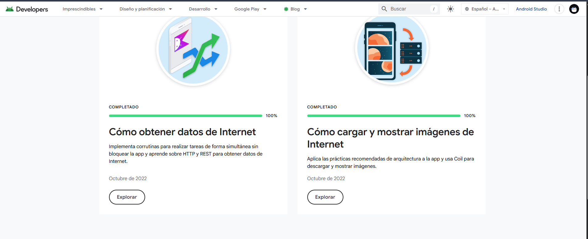

# Mobile Computing Codelabs


> Practical implementations of modern Android development pathways, focusing on concurrent execution with coroutines, remote REST networking, dependency injection, and persistent background task scheduling with WorkManager.

## Overview

This repository gathers practical lab solutions developed for the Mobile Computing course (Computación Móvil 2026-2) at Universidad de Antioquia. It consolidates all hands-on codelab assignments into a single monorepo, covering core Android engineering topics:

- Asynchronous programming and structured concurrency using Kotlin Coroutines.
- Networking architectures consuming REST APIs through Retrofit, JSON parsing with Gson and Kotlinx Serialization, and asynchronous image loading with Coil.
- Clean Architecture principles leveraging manual Dependency Injection via container hierarchies and the Repository pattern.
- Background processing, worker chaining, and asynchronous task management through Android Jetpack WorkManager.

All solutions within this repository are configured as independent, reproducible Gradle projects built with modern Jetpack Compose.

## Repository Information & Authors

- **Repository:** [https://github.com/Isa-Bedoya-UdeA/mobile-computing-codelabs](https://github.com/Isa-Bedoya-UdeA/mobile-computing-codelabs)

### Authors
- **Isabela Bedoya Gaviria** ([GitHub](https://github.com/Isa-Bedoya-UdeA))
- **Rafael Angel Aleman Castillo** ([GitHub](https://github.com/Aleman710))

---

## Course Pathway Analysis & Organization Notes

During the review of the assigned reference links, the following structural relations were identified:

1. **Unit 5 / Link 1 vs. Link 2 Consolidation:**
   - Link 1 pointed to the overarching **Unit 5: Connect to the Internet** learning track.
   - Link 2 corresponded directly to the *RaceTracker* coroutines practice in Android Studio, which is already an internal section of Unit 5 (Pathway 1). Consequently, Link 2 was part of Link 1 and was completed without duplication.

2. **Network Services Project Scope:**
   - The *Mars Photos* project starts with basic network queries and evolves through repository abstraction, manual dependency injection, and image caching.
   - The *Amphibians* and *Bookshelf* projects serve as end-of-unit comprehensive assignments reinforcing REST consumption, data mapping (Gson / Serialization), and repository-driven UI binding.

3. **Background Scheduling Scope:**
   - The *Blur-O-Matic* project covers Jetpack WorkManager, demonstrating `CoroutineWorker` execution, input/output data parameterization, and sequential worker chains (`CleanupWorker` -> `BlurWorker` -> `SaveImageToFileWorker`).

### Unit 5 Completion Verification



---

## Repository Structure

```text
mobile-computing-codelabs/
├── 01-ConectarseAInternet/
│   ├── 1-ComoObtenerDatosDeInternet/
│   │   ├── 01-Coroutines/
│   │   │   └── IntroAndroidStudio/             # RaceTracker coroutines practice & unit tests
│   │   └── 3-ObtenerDatosInternet/
│   │       └── basic-android-kotlin-compose-training-mars-photos-starter/
│   │                                           # Mars Photos: Retrofit, Kotlinx Serialization, and UI states
│   └── 2-ComoCargarYMostrarImagenesDeInternet/
│       ├── 1-ComoAgregarRepo&DIManual/
│       │   └── basic-android-kotlin-compose-training-mars-photos-repo-starter/
│       │                                       # Repository pattern, AppContainer DI, and unit test fakes
│       ├── 2-ComoCargar&MostrarImagenesDeInternet/
│       │   └── basic-android-kotlin-compose-training-mars-photos-coil-starter/
│       │                                       # Coil AsyncImage grid display and retry mechanisms
│       ├── 3-CompilarAppsDeAnfibios/
│       │   └── Amphibians/                     # Complete Amphibians app with Retrofit, Coil, and DI
│       └── 4-CrearAppBookshelf/
│           └── Bookshelf/                      # Google Books API integration with Gson and search UI
├── 02-TrabajoSegundoPlanoWorkManager/
│   └── basic-android-kotlin-compose-training-workmanager-starter/
│                                               # Blur-O-Matic: WorkManager chaining with CoroutineWorkers
├── assets/
│   └── unidad5.png                             # Completion verification screenshot for Unit 5
└── README.md
```

---

## License

This project is licensed under the terms specified in the [LICENSE](LICENSE) file.
